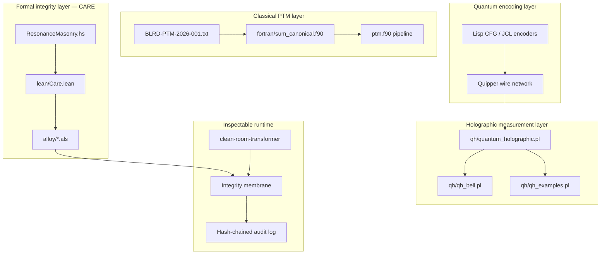

# Negative Quantum Holographic — Extracted System

**Repository:** [AHMADALIPARR/negative-quantum-holographic-extracted](https://github.com/AHMADALIPARR/negative-quantum-holographic-extracted)  
**Upstream source:** [SNAPKITTYWEST/negative-quantum-holographic](https://github.com/SNAPKITTYWEST/negative-quantum-holographic)  
**License:** AGPL-3.0 (see upstream `LICENSE-AGPL`)

This repository is a working extract and reorganization of the Negative Quantum Holographic (NQH) research stack. It is not a marketing scaffold. It is a multi-language formal and executable system that links classical polynomial Turing-machine semantics, quantum circuit encodings, probabilistic holographic measurement, and a machine-level integrity invariant called **CARE**.

---

## What this system is

Negative Quantum Holographic is a research architecture for **inspectable** quantum–classical pipelines. The name is deliberate:

- **Quantum** refers to circuit and amplitude models (Quipper wires, Prolog amplitude engines, holographic measurement).
- **Holographic** refers to representing global behavior through local amplitudes, quasi-probability weights (including negative quasi-weights), and Born-rule recovery.
- **Negative** refers both to negative quasi-probability mass in the holographic layer and to the adversarial space the formal tools call **Dark Masonry**—transitions that violate integrity.

The system is built so that every important claim is tied to something you can run or check:

| Layer | Job |
|-------|-----|
| Classical PTM (Fortran) | Deterministic polynomial machine semantics; canonical numeric checks |
| Quantum wires (Quipper / Lisp) | Circuit banks and JCL/CFG encoders |
| Holographic engine (Prolog) | Amplitudes, interference, quasi-negativity, PITA/cplint measurement |
| Resonance Masonry (Haskell / Lean / Alloy) | Geometry→ethic morphism, SUBLEQ resonance, CARE vs Dark Masonry |
| Clean-room transformer (Python) | Decoder-only model whose every boundary is membrane-checked |
| BLRD specification | Bit- and byte-level reference document for the PTM vault |

The point is not to claim quantum speedup. The point is **reproducible structure**: if a transition is accepted, CARE held; if a measurement is reported, the amplitude model produced it; if a Fortran sum is claimed, the binary matches the canonical value.

---

## Architecture (system diagram)



**How to read the diagram.** Classical sources are specified at binary level (BLRD), executed in Fortran, and treated as the deterministic baseline. Quantum structure is encoded in Quipper and Lisp, then interpreted by the holographic Prolog engine for interference and Born probabilities. Resonance Masonry gives an executable and formal model of “light” (integrity-preserving) versus “dark” (adversarial) transitions. CARE is the shared invariant: protected sets do not change; authority may only expand through explicit grant. The clean-room transformer is a separate but related runtime experiment: a small neural decoder whose tensor boundaries are policed by the same integrity mindset (membrane, quarantine, audit).

---

## Core idea: CARE

CARE is the machine-level integrity predicate used across Lean, Alloy, and the Haskell reference model.

```text
Care(s, s')  ⇔
    Protected(s) = Protected(s')
    ∧  Authority(s') ⊆ Authority(s) ∪ Granted(s)
```

- **Protected** is the set of capabilities that must not change across a step.
- **Authority** is what the machine currently may exercise.
- **Granted** is the only legal source of new authority on the next state.

**Dark Masonry** is defined as a transition that is privileged and does *not* satisfy CARE. Alloy searches for such counterexamples in a finite scope; Lean proves structural consequences of assuming CARE globally (for example, that global CARE implies no Dark Masonry transition exists). God-domain capabilities are ordinary capabilities in a distinguished set—they are **not** a bypass of CARE.

This is the formal spine of the repository. Everything else either feeds data into pipelines that must eventually respect CARE, or demonstrates measurement and encoding that sit beside that integrity story.

---

## Demo table (runnable surface)

| # | Demo | Command | Expected result | Requirements |
|---|------|---------|-----------------|--------------|
| 1 | Fortran canonical sum | `cd fortran && gfortran -O2 -o sum_canonical sum_canonical.f90 && ./sum_canonical` | `SUM(1..100) = 5050`, hex `0x000013BA`, `PASS` | `gfortran` |
| 2 | CARE theorems | `lean resonance_masonry/lean/Care.lean` | Module loads; theorems type-check | Lean 4 |
| 3 | Alloy CARE search | `cd resonance_masonry/alloy && ./run-alloy.sh CareInvariant.als` | Bounded `careGlobal` / counterexample runs | Alloy 6 jar, Java |
| 4 | Alloy CONNECT | `./run-alloy.sh Connect.als` | CARE-gated syscall vs dark syscall | Alloy 6 |
| 5 | Alloy SUBLEQ | `./run-alloy.sh ResonantSubleq.als` | PC step, trap/god domain | Alloy 6 |
| 6 | Haskell resonance | `cd extracted/resonance_masonry && runghc ResonanceMasonry.hs` | `OpInvariant True`, `CARE True`, `DarkCrossing False`, PC period `Just 1` | GHC / `runghc` |
| 7 | Bell holographic | `swipl -s qh/qh_bell.pl` then `?- demo_bell.` | `P(up,up)=0.64`, `P(down,down)=0.36` | SWI-Prolog, pita/cplint |
| 8 | Full upstream pull | `./scripts/bootstrap-complete.sh` | `upstream/` + full `extracted/` including CRT, Quipper, BLRD | `git`, `curl`/`tar` |

---

## Demo walkthroughs

### Demo 1 — Classical baseline (Fortran)

The file `fortran/sum_canonical.f90` implements the BLRD canonical program `PROGRAM SUM` that accumulates `1..100`. The expected total is **5050**, which is also **0x000013BA** in 32-bit hex. This is a regression gate: if the toolchain or encoding drifts, the check fails. The Makefile can also build `ptm_pipeline` once `ptm.f90` is present (via bootstrap).

### Demo 2–5 — Formal CARE stack

`resonance_masonry/lean/Care.lean` defines `Cap`, `State`, `Care`, `Privileged`, and `DarkMasonry`, and proves lemmas such as protected-set preservation under CARE and “global CARE ⇒ no Dark Masonry.” Alloy models in `resonance_masonry/alloy/` ask the dual question in a finite universe: does a Dark Masonry transition exist in this scope? `Connect.als` ties CARE to syscall edges (authorize vs trap). `ResonantSubleq.als` links control-flow PC steps to domain transitions.

### Demo 6 — Executable Resonance Masonry

`extracted/resonance_masonry/ResonanceMasonry.hs` is the runnable reference model from the upstream tar. It builds a geometric state, maps it through `psi` into an ethic/sp state, checks light-masonry invariants, evaluates CARE on a sample transition, and runs a trivial SUBLEQ machine to report PC period and a 1 GHz resonance estimate. This is the bridge between “formal story” and “print numbers.”

### Demo 7 — Holographic Bell measurement

`qh/qh_bell.pl` encodes a two-qubit Bell-like amplitude table and uses the cplint/PITA bridge for probabilistic queries. Joint and marginal probabilities are deterministic consequences of the amplitude table; the conditional readout demo shows a noisy reporting channel on top of the ideal same-spin structure.

### Demo 8 — Completing the tree

Several large artifacts (full clean-room transformer sources and tests, 1503-line Quipper network, 397 KB BLRD text) are intentionally fetched by `scripts/bootstrap-complete.sh` rather than duplicated through the API. After bootstrap, `upstream/` is a full mirror and `extracted/` contains every unpacked archive.

---

## File inventory (what is in this repo and what it does)

### Root

| Path | Role |
|------|------|
| `README.md` | This document: system explanation, demos, inventory |
| `EXTRACT.md` | Short notes on extract status and upstream mapping |
| `scripts/bootstrap-complete.sh` | Clones upstream, rsyncs mirror, extracts all `.tar.gz`, copies BLRD |

### `fortran/` — classical PTM surface

| Path | Role |
|------|------|
| `Makefile` | Builds `sum_canonical` and `ptm_pipeline`; `make test` runs both |
| `sum_canonical.f90` | Canonical SUM program; verifies 5050 / 0x13BA |

### `qh/` — quantum-holographic Prolog layer

| Path | Role |
|------|------|
| `qh_bell.pl` | Bell-like amplitude pairs; `demo_bell`, `demo_marginal`, `demo_conditional` |
| `qh_examples.pl` | Interference, unitary mix, quasi-negativity, Born rule demos |

*(Full engine modules `quantum_holographic.pl` / `qh_cplint.pl` land under `upstream/qh/` after bootstrap.)*

### `resonance_masonry/` — formal CARE and resonance

| Path | Role |
|------|------|
| `lean/Care.lean` | CARE definitions and theorems (protected, authority, Dark Masonry) |
| `lean/ResonanceMasonry.lean` | Geometry/ethic types, `psi`, light-masonry predicates |
| `alloy/CareInvariant.als` | Bounded CARE global vs counterexample search |
| `alloy/Connect.als` | CARE-gated syscalls vs dark syscalls |
| `alloy/ResonantSubleq.als` | SUBLEQ PC steps, god/trap domains, resonance runs |
| `alloy/run-alloy.sh` | Batch Alloy runner (expects `ALLOY_JAR`) |

### `extracted/resonance_masonry/` — pure tar extract (executable)

| Path | Role |
|------|------|
| `ResonanceMasonry.hs` | Runnable Haskell model (invariants, CARE, SUBLEQ trace) |
| `build.sh` | Compiles HS; optionally invokes Liquid Haskell and Lean |
| `README.md` | Notes on HS / LHS / Lean artifacts from the tar |

### `extracted/clean-room-transformer/` — partial pure tar extract

| Path | Role |
|------|------|
| `requirements.txt` | Pinned `numpy` + `cryptography` with hashes |
| `requirements-dev.txt` | `pytest` only |
| `conftest.py` | Puts `src/` on `sys.path` without install |
| `.gitignore` | Ignores caches, audit dumps |

*(Full `src/`, `tests/`, `scripts/`, Docker image: after bootstrap.)*

### `extracted/specs/`

| Path | Role |
|------|------|
| `README.md` | How to fetch `BLRD-PTM-2026-001.txt` (397 KB PTM binary-level spec) |

### `quantum-wires/`

| Path | Role |
|------|------|
| `quipper/README.md` | Documents the 1503-line Quipper wire bank; curl command for the full file |
| `extracted/` | Earlier organization notes and partial CRT/resonance copies |

---

## Design constraints (explicit)

1. **No silent god-mode.** Privilege domains are modeled; they do not cancel CARE.
2. **Bounded checkers are not infinite proofs.** Alloy results are scope-relative; Lean carries the proof-obligation side.
3. **Determinism where claimed.** Fortran gates and the clean-room transformer’s single-threaded numeric path exist to make bit-level claims testable.
4. **Large artifacts are fetched, not faked.** Quipper’s full network and the BLRD text are real upstream files; the bootstrap script is the honest way to materialize them.

---

## Relationship to upstream

Upstream contains additional trees not all duplicated here yet: full `resonance_masonry` (Isabelle, ASP, Rust, Prolog operative masonry, SupremeKernel), `lisp/` encoders, `sgmt/` crystallization, `submissions/` agent XML, and the complete clean-room transformer test suite. This extract prioritizes **runnable demos** and **CARE formalization**. Use bootstrap when you need the entire SNAPKITTYWEST tree on disk.

---

## Quick start (minimal path)

```bash
git clone https://github.com/AHMADALIPARR/negative-quantum-holographic-extracted.git
cd negative-quantum-holographic-extracted

# classical gate
(cd fortran && gfortran -O2 -o sum_canonical sum_canonical.f90 && ./sum_canonical)

# executable resonance model
(cd extracted/resonance_masonry && runghc ResonanceMasonry.hs)

# formal CARE (if Lean installed)
lean resonance_masonry/lean/Care.lean

# full upstream + archives
chmod +x scripts/bootstrap-complete.sh && ./scripts/bootstrap-complete.sh
```

---

## Summary

Negative Quantum Holographic is a **layered integrity and measurement stack**: classical PTM baselines, quantum wire encodings, holographic probability with explicit quasi-weights, and a shared CARE invariant checked in Lean and Alloy and exercised in Haskell. This repository packages the parts needed to **demonstrate** those layers, documents every file currently in-tree, and provides a single script to pull whatever remains from upstream so the system is complete on disk—not merely described.
